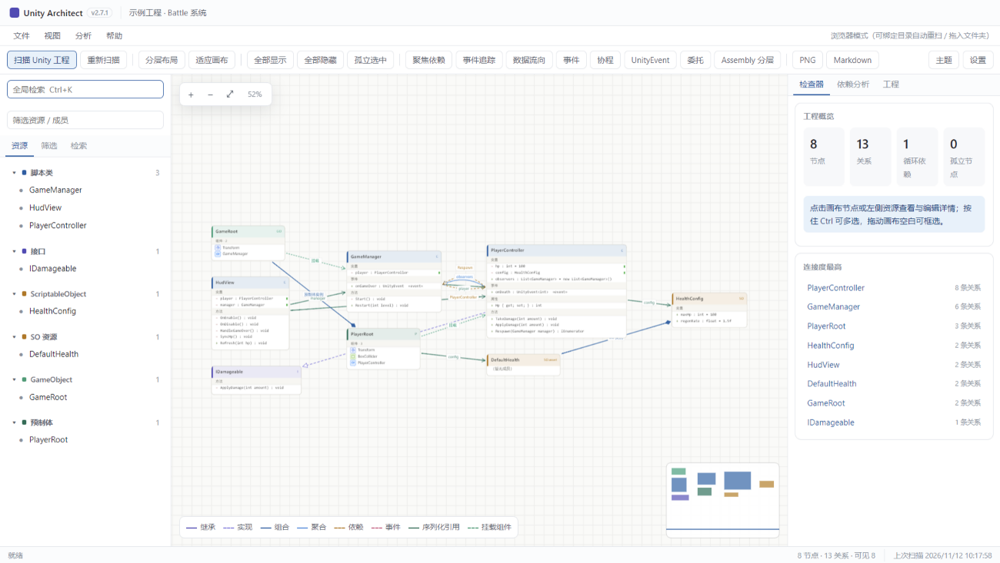
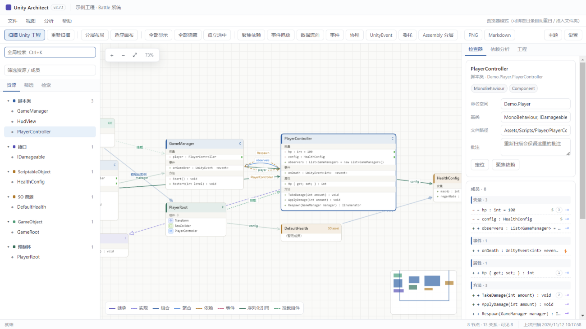
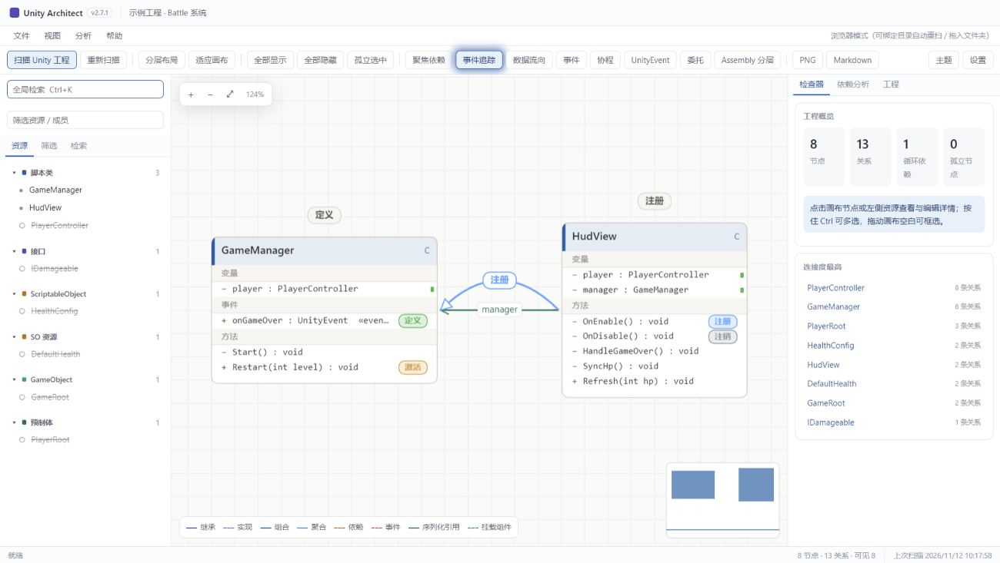
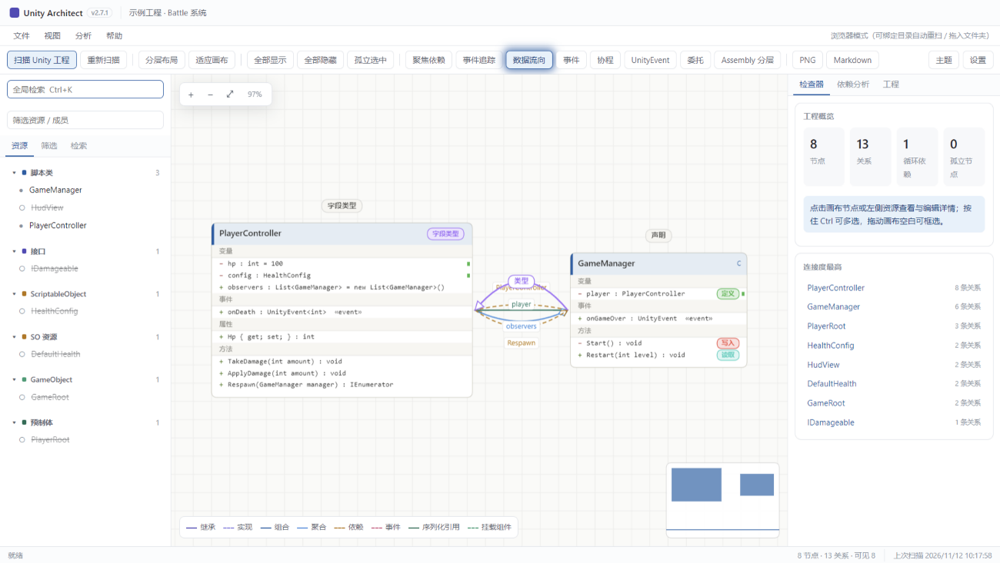
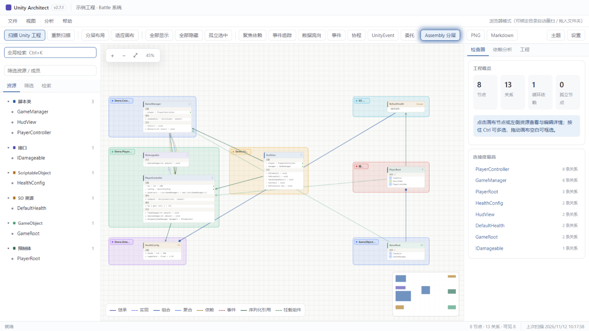
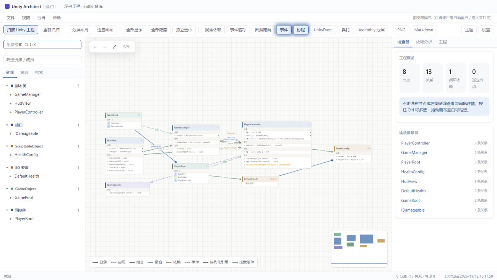

# Unity 关系梳理器 · Unity Architect

> 用来快速查看 Unity 项目当中各种对象之间的关系和构成。

扫描 Unity 工程的 C# 脚本与场景 / 预制体 / SO 资源，生成一张带 UML 语义的引用关系图。**纯本地、只读、不修改工程**：选一次目录就能看到谁引用了谁、事件从哪触发、数据怎么流动。

---

## 功能

### 脚本关系图

类 / 接口 / 结构体 / 枚举 / ScriptableObject 节点，卡片内直接列出成员（变量 / 事件 / 属性 / 方法），自动区分**继承 / 实现 / 依赖 / 组合**等关系；左侧资源树按类型分组检索，右侧检查器展示选中节点的完整信息。



选中节点后右侧检查器会列出全部成员与组件；GameObject / 预制体卡片按 YAML 顺序列出组件清单（移动轴 / 碰撞盒 / 相机 / 灯光 / 声音 / 动画各有类型图标，自定义脚本显示 C# 图标）。**已解析的脚本组件会生成独立实例节点**（挂载 → 实例 → 实例化类型），脚本字段的序列化引用从实例出发，`Player 的 PlayerMover 实例 --dataBase--> GameRoot 的 GameDataBase 实例` 这样组件级关系一目了然；同一脚本挂载多处时实例名自动带宿主名（`PlayerMover @Player`）。



### 查找所有引用（Visual Studio 式）

- **事件追踪**：三列聚拢展示 `定义 → 注册/注销 → 激活`，右侧列出引用方与代码行；同名事件按类型隔离不串线
- **数据流向**：`字段类型 → 声明 → 写入 → 读取`，支持多跳链路（SO 资源 → 字段 → 方法参数 → 另一字段）
- **方法调用**：`定义 → 调用`，方法组引用（`+= Refresh`）同样计入





### Assembly 分层视图

读取 `.asmdef`，按程序集依赖**自顶向下分层**：主链（如 `Demo.Core 层 → Demo.Player 层 → Demo.UI 层 → Demo.Data 层`）一条竖线左对齐，同 depth 的平级层左右并排；SO 资源 / 预制体 / GameObject 层 / Editor 各自成组排在右侧栏，互不混杂。



### 成员高亮开关

工具栏 **事件 / 协程 / UnityEvent / 委托** 四个开关，把对应成员的文字一键染成醒目颜色并加粗（图中协程成员 `Respawn` 已染橙色），复杂类里一眼定位。



### 项目体检（v2.11.0）

工具栏「体检」或快捷键 **H**：一键诊断全项目，输出健康分（0–100）与可执行的问题清单——**循环依赖**（点击环条目进入**环形视图**：环内类排成一圈、关系线红色强调）、**耦合中心**（被引用最多的类）、**上帝类**（成员过多）、**孤立脚本**、**空壳类型**、**缺命名空间**、**失效节点**；每条可点击直接定位。GameObject 间的环会标出具体引用组件：链路标签显示「字段名 · 组件」（如 `goB · Transform`），被指向的组件行挂「序列化」徽章，方便区分对象级环与组件级环。

### 其他观察工具

聚焦依赖、孤立节点、循环依赖、扫描差异对比、全局检索（Ctrl+K）、暗色主题、导出 PNG / Markdown；任一画布模式同一时间只生效一个，对应按钮持续发光提示当前状态。数据溯源视图的中间过程节点也带成员级引用徽章（聚合 / 组合 / 依赖 + 成员名）。

## 使用（不需要装任何环境）

**方式一：桌面版（推荐）**

下载 Release 中的 `UnityArchitect-<版本>-win64.zip`，解压后双击 `UnityArchitect.exe`，点「扫描 Unity 工程」选择工程根目录（含 `Assets` 和 `Library` 的那一层）。免安装，Win10/11 64 位。

**方式二：网页版单文件**

Release 里同时提供了 `UnityArchitect-standalone.html`（单文件 HTML），用 Chrome / Edge 打开即用，功能完整；也可以直接拖整个工程文件夹进窗口。浏览器受安全限制，只能拿到文件夹名，拿不到完整磁盘路径。

自己构建的话，`npm run build:html` 会在仓库根目录生成同名的 `UnityArchitect-standalone.html`（该文件不入库，属于构建产物）。

## 从源码构建

需要 Node.js 18+。

```bash
npm install

npm start          # 开发模式启动桌面版
npm run dev        # 带 DevTools 的开发模式
npm run build:html # 只生成网页版单文件 HTML
npm run build:app  # 只打便携版 exe（dist/）
npm run release    # 一键打包：检查 + 测试 + 网页版 + exe + 分发 zip
```

Windows 下双击仓库根目录的 **`一键打包.cmd`** 等同 `npm run release`。

打包时自动把 `assets/icon.ico` 写入 exe（任务栏 / 标题栏 / 文件图标）并设置产品名；更换图标只需替换 `assets/icons/icon-*.png`（或运行 `electron tools/build-icon.js <新图片>` 从任意图片重新生成圆形图标）。

## 扫描范围

| 纳入 | 说明 |
|---|---|
| `.cs` | 类型、成员、类间依赖、方法体引用 |
| `.meta` | GUID ↔ 脚本名映射（含 `Library/PackageCache`，用于解析官方包组件真名） |
| `.prefab` / `.unity` | GameObject、组件挂载、预制体实例 |
| `.asset` | ScriptableObject 资源实例及序列化字段引用 |
| `.asmdef` | 程序集定义与引用关系 |

自动跳过 `Library` / `Temp` / `obj` / `Build` / `.git` 等目录；单次上限 2 万文件 / 48MB。

## 常见问题

- **官方包组件都显示 MonoBehaviour**：请选**工程根目录**（含 `Library`），只选 `Assets` 会导致读不到 PackageCache 的 `.cs.meta`
- **事件追踪 / 数据流向为空**：重新扫描一次即可生成方法体引用记录
- **Assembly 分层提示没有 asmdef**：工程里没有 `.asmdef`，无法按程序集分层
- **SO 资源没出现在图里**：只有 `m_Script` 能对应到工程内脚本类型的 `.asset` 才会生成节点
- **浏览器里目录授权被拦**：把工程文件夹直接拖进窗口，或用「选择文件夹（兼容模式）」

更多细节见 [`docs/使用说明.md`](docs/使用说明.md)。

## 目录结构

```
src/shared/    解析 / 布局 / 分析层（Node 与浏览器共用，UMD）
src/renderer/  画布、界面与交互
electron/      桌面版外壳、目录扫描、IPC
tools/         网页版打包、便携版打包、一键发布
tests/         单元测试、浏览器扫描测试、Electron 探针
docs/          使用说明、README 截图（docs/images/）
```

## 隐私

所有解析都在本机内存中完成，**不上传任何代码或工程数据**，不联网。

## License

[MIT](LICENSE) © 2026 326435399
